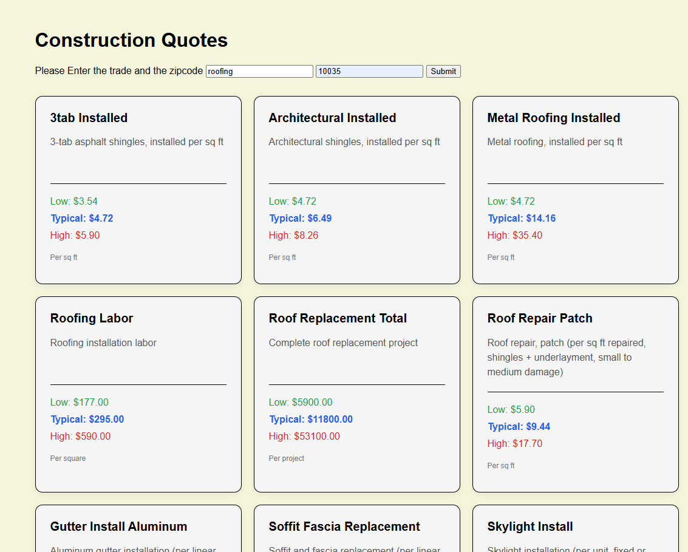

# Construction Quotes

A web application that helps contractors, homeowners, and construction professionals explore estimated service costs based on trade and ZIP code.

Built with HTML, CSS, and JavaScript, the application integrates with the EstimationPro API to retrieve regionally adjusted construction cost estimates and present them in an easy-to-read interface.

## Live Demo

**[View Construction Quotes](https://anwaralshohatee.github.io/construction-app/)**

## Technologies


## Features

- Search construction cost estimates by trade and ZIP code
- Retrieve estimates from the EstimationPro API
- Filter results to include regionally adjusted pricing
- Display low, typical, and high cost estimates
- Show service descriptions and pricing units
- Dynamically generate service cards using JavaScript
- Organize results in a grid layout
- Support searches using the Submit button or Enter key

## Screenshot



## How It Works

1. Enter a construction trade, such as `roofing`.
2. Enter a ZIP code, such as `10035`.
3. Click **Submit**.
4. The application requests cost information from the EstimationPro API.
5. It filters the returned services for regionally adjusted estimates.
6. Each service is displayed with its description, pricing range, and unit of measurement.

## API Used

### EstimationPro API

Provides construction service cost estimates based on trade and geographic location.

The application uses the API's cost endpoint to retrieve pricing information, including:

- Service name and description
- Low estimated cost
- Typical estimated cost
- High estimated cost
- Pricing unit
- Regional adjustment information

These figures are estimates and should not be treated as guaranteed contractor quotes.

## Getting Started

### 1. Clone the Repository

```bash
git clone https://github.com/AnwarAlshohatee/construction-app.git
cd construction-app
```

### 2. Run the Application

Open `index.html` in your browser.

No additional dependencies or installations are required.

An internet connection and access to the EstimationPro API are required.

## Future Improvements

- Add input validation for trade names and ZIP codes
- Add loading indicators and API error messages
- Support filtering by service category
- Allow users to save or compare estimates
- Add a project cost calculator based on quantities
- Improve mobile responsiveness

## Author

**Anwar Alshohatee**

[Portfolio](https://anwaralshohatee.netlify.app) | [LinkedIn](https://www.linkedin.com/in/anwaralshohatee/)
